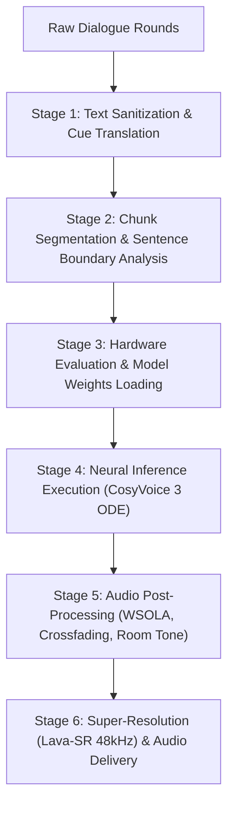
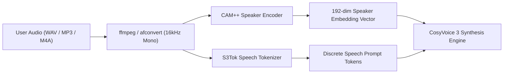

# Inside Magic-Voice AI: From Architecture to Execution

> A comprehensive deep-dive into running, building, and understanding **Magic-Voice AI** — a local, private, neural multi-speaker Text-to-Speech (TTS) studio powered by **CosyVoice 3**, **Metal GPU acceleration**, and **Lava-SR 48kHz super-resolution**.

---

## Table of Contents

1. [Introduction](#1-introduction)
2. [Part 1: Getting Started — Installation & Execution](#part-1-getting-started--installation--execution)
   - [Prerequisites](#prerequisites)
   - [Clone & Dependencies Installation](#clone--dependencies-installation)
   - [Running in Development Mode](#running-in-development-mode)
   - [Building for Production (macOS & Windows)](#building-for-production-macos--windows)
   - [Initial Launch & Model Download](#initial-launch--model-download)
3. [Part 2: High-Level System Architecture](#part-2-high-level-system-architecture)
   - [The Two-Tier Electron Topology](#the-two-tier-electron-topology)
   - [Context Isolation & Typed IPC Bridge](#context-isolation--typed-ipc-bridge)
   - [Renderer Architecture (React 18 + Jotai + Tailwind CSS)](#renderer-architecture-react-18--jotai--tailwind-css)
   - [Main Process Core Services](#main-process-core-services)
   - [Prisma ORM & SQLite Storage](#prisma-orm--sqlite-storage)
4. [Part 3: Under the Hood — The Neural Audio Engine](#part-3-under-the-hood--the-neural-audio-engine)
   - [The CosyVoice 3 Multi-Model Ensemble](#the-cosyvoice-3-multi-model-ensemble)
   - [Hardware Inference: Metal GPU vs. CPU](#hardware-inference-metal-gpu-vs-cpu)
   - [The 6-Stage Speech Synthesis Pipeline](#the-6-stage-speech-synthesis-pipeline)
   - [Conversational Prosody & Tag Translation](#conversational-prosody--tag-translation)
   - [Zero-Shot Voice Cloning (CAM++ & S3Tok)](#zero-shot-voice-cloning-cam--s3tok)
   - [Acoustic Post-Processing: Crossfading & Room Tone](#acoustic-post-processing-crossfading--room-tone)
   - [Lava-SR 48kHz Ultra-HD Upsampling](#lava-sr-48khz-ultra-hd-upsampling)
5. [Part 4: State Management & UI Architecture](#part-4-state-management--ui-architecture)
   - [Decoupled Global Store vs. Local Component State](#decoupled-global-store-vs-local-component-state)
   - [Responsive Multi-Speaker Dialogue Scripting](#responsive-multi-speaker-dialogue-scripting)
   - [Interactive Waveforms & Scrubbing](#interactive-waveforms--scrubbing)
6. [Part 5: Troubleshooting & Best Practices](#part-5-troubleshooting--best-practices)
7. [Conclusion](#conclusion)

---

## 1. Introduction

Traditional Text-to-Speech (TTS) solutions typically rely on centralized cloud services (such as OpenAI TTS, ElevenLabs, or Amazon Polly). While effective, cloud TTS introduces bandwidth latency, ongoing API subscription fees, vendor lock-in, and significant privacy concerns when synthesizing proprietary documents, creative scripts, or sensitive conversations.

**Magic-Voice AI** is an open-source, desktop-native Text-to-Speech studio engineered to run entirely on your local machine with zero external network calls during synthesis. By wrapping FunAudioLLM’s state-of-the-art **CosyVoice 3** architecture inside an Electron and React desktop application, Magic-Voice AI provides:

- **Local Zero-Shot Voice Cloning**: Clone any voice from a 3-to-15 second reference audio sample using deep speaker embeddings.
- **Multi-Speaker Dialogue Studio**: Script complex conversations between multiple characters with independent pacing, emotions, and inter-turn pauses.
- **Natural Respiration & Acting Cues**: Inject natural laughter, smiles, sighs, whispers, and emphatic phrases directly into the text.
- **Hardware Acceleration**: High-performance Apple Silicon Metal GPU shaders with seamless CPU fallback.
- **Studio-Grade 48kHz Audio**: Built-in spectral upsampling via Lava-SR.

---

## Part 1: Getting Started — Installation & Execution

### Prerequisites

Before compiling or running Magic-Voice AI, ensure your system meets the following specifications:

- **Operating System**:
  - **macOS**: Apple Silicon (M1/M2/M3/M4) recommended for fast real-time Metal GPU synthesis; Intel (x64) supported via CPU.
  - **Windows**: Windows 10/11 64-bit (x64).
- **Node.js**: Version 18.0.0 or later (LTS v20+ recommended).
- **Package Manager**: `npm` (bundled with Node.js).
- **Disk Space**: At least **4 GB** of free storage to house the CosyVoice 3 model weights (`~/.qvac/models/`).

### Clone & Dependencies Installation

1. Clone the repository to your local machine:
   ```bash
   git clone https://github.com/your-username/Magic-Voice-ai.git
   cd Magic-Voice-ai
   ```

2. Install the required Node dependencies and generate the Prisma SQLite client:
   ```bash
   npm install
   ```
   *(The `postinstall` script automatically executes `prisma generate` to compile typed database bindings for the Electron runtime).*

### Running in Development Mode

To launch the application in development mode with live Hot Module Replacement (HMR) for the React frontend and automatic Electron main process reloading:

```bash
npm run dev
```

Under the hood, `npm run dev` executes:
1. `prisma generate`: Verifies that Prisma client bindings match the schema in `prisma/schema/`.
2. `vite`: Launches the Vite development server on `http://localhost:5173`.
3. `vite-plugin-electron`: Compiles `electron/main.ts` and `electron/preload.ts`, launches the native Electron window, and binds the renderer process to the Vite dev server.

### Building for Production (macOS & Windows)

Magic-Voice AI utilizes `electron-builder` to produce distributable installers:

```bash
# Type check TypeScript codebase
npx tsc --noEmit

# Compile both frontend and Electron bundles
npm run build

# Build macOS DMG installer (arm64 Apple Silicon + x64 Intel)
npm run build:dmg

# Build Windows installer (NSIS executable)
npm run build:win

# Build all supported platform targets
npm run build:all
```

Packaged installers will be placed inside the `release/` directory.

### Initial Launch & Model Download

When launching Magic-Voice AI for the first time:

1. The application checks `~/.qvac/models/` for the five required neural models.
2. If models are missing, the UI presents the **Install Required Models** screen.
3. Clicking **Download All Models** triggers asynchronous downloads directly from the official Hugging Face / QVAC repository via `@qvac/sdk`.
4. Live progress bars track download speed and disk verification.
5. Once verified, the application unlocks the full Text-to-Speech studio workspace.

---

## Part 2: High-Level System Architecture

Magic-Voice AI follows a clean, decoupled architecture dividing responsibilities between the **UI Renderer Process** (presentation, scripting, user feedback) and the **Electron Main Process** (hardware evaluation, neural inference, audio mastering, disk I/O).

```
+--------------------------------------------------------------------------+
|                        React Frontend Application                        |
|                                                                          |
|  +--------------------+   +---------------------+   +-----------------+  |
|  | TextToSpeechScreen |   |   SettingsDrawer    |   |  Settings Page  |  |
|  +--------------------+   +---------------------+   +-----------------+  |
|            |                         |                       |           |
|            v                         v                       v           |
|  +--------------------------------------------------------------------+  |
|  |                 Jotai State Store & Custom Hooks                   |  |
|  |    (ttsStore, modelsStore, allRequiredModelsReadyAtom, useModels)  |  |
|  +--------------------------------------------------------------------+  |
+--------------------------------------------------------------------------+
                                     |
                       IPC Bridge (electron/preload.ts)
                                     |
+--------------------------------------------------------------------------+
|                       Electron Main Process Core                         |
|                                                                          |
|  +---------------------+   +---------------------+   +-----------------+ |
|  |  SystemController   |   |   ModelsController  |   |  TtsController  | |
|  +---------------------+   +---------------------+   +-----------------+ |
|            |                         |                       |           |
|            v                         v                       v           |
|  +---------------------+   +---------------------+   +-----------------+ |
|  |    SystemService    |   |    ModelsService    |   |    TtsService   | |
|  +---------------------+   +---------------------+   +-----------------+ |
|            |                                                 |           |
|            |  Hardware Device Event: onInferenceDeviceChanged|           |
|            +------------------------------------------------>+           |
|                                                              |           |
|                                                              v           |
|                                                    +-------------------+ |
|                                                    | VoiceEngineService| |
|                                                    +-------------------+ |
|                                                              |           |
|                                                              v           |
|                                                    +-------------------+ |
|                                                    |     @qvac/sdk     | |
|                                                    | (CosyVoice 3 ODE) | |
|                                                    +-------------------+ |
|                                                              |           |
|                                                              v           |
|                                                    +-------------------+ |
|                                                    |  Prisma / SQLite  | |
|                                                    +-------------------+ |
+--------------------------------------------------------------------------+
```

### The Two-Tier Electron Topology

- **Renderer Process (`src/`)**: A Single Page Application (SPA) built with React 18, TypeScript, Tailwind CSS v4, and Radix UI primitives. It does not possess direct Node.js filesystem access, ensuring sandbox security and clean UI responsiveness.
- **Main Process (`electron/`)**: A Node.js runtime process that initializes the Electron `BrowserWindow`, orchestrates C++ native bindings via `@qvac/sdk`, handles audio signal processing, manages the SQLite database, and handles operating system filesystem operations.

### Context Isolation & Typed IPC Bridge

Communication between the Renderer and Main process is mediated exclusively through `electron/preload.ts` using Electron’s secure `contextBridge.exposeInMainWorld('ipcRenderer', ...)` pattern.

All IPC channels are strictly typed under `electron/core/ipc-channels.ts`:

| Domain | Channel Identifier | Functionality |
| :--- | :--- | :--- |
| **System** | `system:getStorageInfo` | Scans disk space for models, exports, and audio media. |
| **System** | `system:getInferenceDevice` | Reads whether compute device is configured to GPU or CPU. |
| **System** | `system:setInferenceDevice` | Switches hardware compute device and persists to disk. |
| **System** | `system:selectMediaFolder` | Opens native folder picker to select export destination. |
| **Models** | `models:get-status` | Verifies SHA-256 and byte sizes of all local weights. |
| **Models** | `models:download` | Streams chunked model downloads with progress callbacks. |
| **Models** | `models:delete-all` | Purges all cached model weights to free up disk space. |
| **TTS** | `tts:generate` | Dispatches multi-speaker dialogue synthesis. |
| **TTS** | `tts:cancel` | Aborts ongoing neural inference and frees memory buffers. |

### Renderer Architecture (React 18 + Jotai + Tailwind CSS)

The UI is built with modern web technologies:
- **Jotai (`jotai`)**: Manages atomic state across components. Heavy operations like dialogue scripts and custom voices are persisted safely to `localStorage`.
- **Framer Motion (`framer-motion`)**: Drives hardware-accelerated animations, sliding tab transitions, modal drawers, and responsive drag-and-drop cards.
- **Tailwind CSS v4 (`@tailwindcss/vite`)**: Implements an Apple-inspired dark aesthetic featuring monochromatic palettes, frosted borders, and translucent overlays.
- **WaveSurfer.js (`wavesurfer.js`)**: Provides interactive audio scrubber bars, peak amplitude representations, and real-time playback synchronization.

### Prisma ORM & SQLite Storage

Persistent data is managed in a local SQLite database (`prisma/echo.db`):
- **Dialogue Scripts & Turns**: Structured storage of multi-turn conversations (`TtsConversation`, `TtsSpeechRound`).
- **Cloned Voices Catalog**: Metadata, audio file references, speaker embedding tags, and gender classifications.
- **System Activity**: Timestamps and metrics for synthesis jobs.

Prisma schema files are organized modularly under `prisma/schema/` (`tts.prisma`, `voices.prisma`, `activity.prisma`, `system.prisma`) and compiled into a unified SQLite schema.

---

## Part 3: Under the Hood — The Neural Audio Engine

Magic-Voice AI does not use a simplistic monolithic TTS model. Instead, it coordinates a modular neural ensemble powered by **CosyVoice 3** (developed by FunAudioLLM) alongside **Lava-SR**.

### The CosyVoice 3 Multi-Model Ensemble

Synthesis relies on five coordinated models:

| Model ID | Component | Architecture | Size | Function |
| :--- | :--- | :--- | :--- | :--- |
| **`cosyvoice3-llm-q8_0`** | Speech Backbone | 0.5B Q8_0 GGUF | ~973 MB | Autoregressive transformer generating speech token sequences conditioned on text and audio prompt tokens. |
| **`cosyvoice3-flow-fp16`** | Acoustic Vocoder | FP16 ODE Flow Matcher | ~639 MB | Continuous flow-matching vocoder synthesizing high-fidelity acoustic waveforms with human breath characteristics. |
| **`cosyvoice3-s3tok-fp16`** | Speech Tokenizer | FP16 Encoder | ~496 MB | Quantizes reference speech waveforms into discrete acoustic tokens for voice cloning. |
| **`cosyvoice3-campplus-fp32`** | Speaker Encoder | FP32 ResNet / CAM++ | ~27 MB | Extracts 192-dimensional deep speaker verification and timbre embeddings. |
| **`lavasr-enhancer`** | Super-Resolution | FP16 Diffusion Model | ~28 MB | Spectral bandwidth upsampler enhancing native 24kHz audio to studio 48kHz Ultra-HD. |

### Hardware Inference: Metal GPU vs. CPU

Magic-Voice AI supports dynamic compute device switching:

- **GPU Mode (Apple Silicon Metal)**: Executes compute graph shaders directly on unified Apple Silicon GPU cores via Metal. This delivers real-time synthesis speeds (up to 3x–5x real-time factor on M-series chips).
- **CPU Mode**: Dispatches tensor operations across standard CPU worker threads using quantized arithmetic. Ideal for Intel Macs or systems where GPU memory is reserved for other workloads.

When a user toggles the compute device in the Settings view:
1. `SystemService` updates `userData/magic-voice-settings.json`.
2. An internal event triggers `VoiceEngineService.setInferenceDevice(device)`.
3. The engine invalidates all loaded model instances in `@qvac/sdk` and flushes GPU buffers.
4. The subsequent synthesis invocation automatically re-initializes models using the chosen backend (`useGPU: inferenceDevice === 'gpu'`).

---

### The 6-Stage Speech Synthesis Pipeline

When the user clicks **Generate Speech**, `VoiceEngineService.synthesizeDialogue()` executes a 6-stage pipeline:



#### Stage 1: Text Sanitization & Cue Translation
- Conversational reaction cues (`[laugh]`, `[sigh]`, `[gasp]`, `[breath]`) and tone tags (`[whisper]`, `[yell]`, `[raise]`) are extracted from the text.
- Punctuation marks are standardized.
- Cues are translated into FunAudioLLM-compliant instructions (`<strong>`, `<breath>`) and Chinese prompt descriptors.

#### Stage 2: Chunk Segmentation
- Long dialogue text is split into natural conversational sentences (maximum 36 words or ~15 seconds per segment).
- Preserving sentence boundaries avoids autoregressive context drift while maintaining prosodic cadence.

#### Stage 3: Model Loading & Reference Conditioning
- `VoiceEngineService` resolves the speaker:
  - If a **preset voice** is selected, pre-extracted speaker embeddings and reference prompt tokens are loaded.
  - If a **cloned voice** is selected, the reference audio file is validated, normalized, and encoded on-the-fly.

#### Stage 4: Neural Inference Execution
- `@qvac/sdk.textToSpeech()` runs the autoregressive LLM to generate acoustic token distributions.
- The continuous flow-matching vocoder integrates ordinary differential equations (ODE) over 10 to 25 Euler steps to generate raw 24kHz PCM audio samples.

#### Stage 5: Audio Post-Processing
- Pre-roll and post-roll dead air generated by neural vocoders is trimmed using an amplitude threshold detector.
- If speed scaling is requested (e.g. 0.8x to 1.5x), the engine runs a native Waveform Similarity Overlap-Add (**WSOLA**) algorithm, preserving pitch while adjusting tempo.
- Consecutive sentences and dialogue rounds are concatenated with 12ms–14ms equal-power crossfades.
- Natural acoustic pauses are inserted:
  - Clause break (comma/semicolon): `0.14s`
  - Sentence boundary: `0.38s`
  - Character speaker switch: `0.65s`

#### Stage 6: Persistence & Audio Delivery
- If **Voice Clarity** is enabled, the 24kHz PCM stream is processed through **Lava-SR**, extending the frequency response up to 48kHz.
- The master PCM buffer is packaged as a standard 16-bit PCM RIFF `.wav` file and written to the user’s configured **Media Destination Folder**.
- A 38-band peak amplitude array is computed for waveform visualization.
- The audio is delivered to the renderer as a Base64 Data URI for instantaneous playback.

---

### Conversational Prosody & Tag Translation

CosyVoice 3 was trained on large-scale multilingual audio paired with natural language instructions. In `qvac-tts.cpp`, the built-in instruction format expects Chinese prompt templates:

$$\text{Prompt: } \text{"You are a helpful assistant. 请用...说一句话。<|endofprompt|>"}$$

Magic-Voice AI bridges English user prompts and cues to native instructions:

```typescript
const COSYVOICE_TONE_INSTRUCT_MAP: Record<string, string> = {
  "warm & smiling": "请用面带微笑、温柔亲切的语气说一句话。",
  "laugh":          "请用开心大笑、忍俊不禁、边笑边说的语气说一句话。",
  "raise":          "请用加重语气、清晰强调重点的语调说一句话。",
  "sigh":           "请轻轻叹一口气，用柔和感慨的语气说一句话。",
  "gasp":           "请用惊讶、倒吸一口气的语气说一句话。",
  "storyteller":    "请用沉稳生动、富有感染力的评书故事语气说一句话。",
  "whisper":        "请用非常微弱的气音和温柔的低语说一句话。"
}
```

Passing these structured instructions before `<|endofprompt|>` steers prosody across all 9 supported languages without leaking extraneous words into the output audio.

---

### Zero-Shot Voice Cloning (CAM++ & S3Tok)

When cloning a custom voice:



1. **Audio Normalization**: Input audio from file upload or microphone recording is converted to 16kHz mono PCM.
2. **CAM++ Embedding**: Extracts the fundamental vocal timbre, formant characteristics, and pitch baseline.
3. **S3Tok Quantization**: Encodes the acoustic texture of the reference audio into discrete token IDs.
4. **Flow Conditioning**: The LLM conditions the new sentence tokens on the reference prompt tokens, producing speech that mirrors the original speaker's vocal characteristics.

---

### Lava-SR 48kHz Ultra-HD Upsampling

Native CosyVoice 3 models generate audio at **24,000 Hz** (24kHz). While natural, 24kHz audio cuts off frequencies above 12kHz, removing the upper "air" and crisp harmonic presence found in studio-grade recordings.

Magic-Voice AI includes **Lava-SR**, a neural spectral super-resolution model:
- Reconstructs missing high-frequency harmonics (12kHz to 24kHz).
- Interpolates the audio stream to **48,000 Hz** (48kHz 16-bit).
- Eliminates vocoder artifacts and breath distortion.
- Controlled via a single toggle switch (**Voice Clarity**) in the right drawer.

---

## Part 4: State Management & UI Architecture

### Decoupled Global Store vs. Local Component State

A frequent challenge in Electron applications is avoiding unnecessary re-renders when updating UI controls. Magic-Voice AI strictly separates **domain state** from **ephemeral UI state**:

- **Global Domain State (`ttsStore.ts` via Jotai)**:
  - Multi-round dialogue scripts, selected voices, volume, and playback state.
  - Automatically persisted to `localStorage` so scripts survive app restarts.
- **Local Component State (`useState` in React components)**:
  - Active tabs in the right sidebar drawer (`'settings'` vs `'history'`).
  - Search filters in the History drawer and Voice Explorer.
  - Keeps high-frequency user interactions (like typing in a search bar or toggling tabs) completely decoupled from global state and disk writes.

### Responsive Multi-Speaker Dialogue Scripting

In `TextToSpeechScreen.tsx`, users can add multiple dialogue rounds:
- Each round possesses its own speaker, speed, emotion, and text.
- Drag-and-drop reordering allows quick dialogue arrangement.
- Focused round selection highlights the active speaker in the right drawer.

### Interactive Waveforms & Scrubbing

Playback is centralized via `GlobalPlayerBar.tsx` and Wavesurfer.js:
- Displays normalized 38-band amplitude peaks computed directly from raw PCM bytes.
- Supports clicking and scrubbing along the waveform.
- Displays dynamic progress counters formatted as `MM:SS`.

---

## Part 5: Troubleshooting & Best Practices

### 1. Optimizing Voice Clones
- **Sample Length**: Use reference samples between **5 and 15 seconds**. Samples under 3 seconds lack sufficient acoustic timbre; samples over 30 seconds can introduce background noise.
- **Background Noise**: Ensure the reference audio has minimal reverberation, echo, or background music. Clean, dry podcast vocals produce the best clones.
- **Prompt Text**: When cloning, provide an accurate transcript of what the speaker says in the reference audio to maximize acoustic alignment.

### 2. Managing Metal GPU Memory on macOS
- If you run heavy 3D rendering or local LLM tools alongside Magic-Voice AI, you can switch the inference device to **CPU** in **Settings > Storage & Hardware**.
- CPU mode uses optimized float threading, preserving unified memory for other applications.

### 3. File Destination & Exports
- By default, synthesized WAV files are saved to `~/Documents/Magic-Voice/Exports`.
- You can change this path at any time under **Settings > Media Destination Folder**.
- Clicking **Open in Finder** (or File Explorer on Windows) opens the export directory immediately.

---

## Conclusion

Magic-Voice AI brings together modern web development, secure desktop architecture, and state-of-the-art neural speech synthesis. By combining **CosyVoice 3**, **CAM++**, **Lava-SR**, **Metal GPU acceleration**, and **Electron**, it offers a private, offline audio workstation capable of producing natural, multi-speaker dialogue.

Whether you are producing audiobooks, voicing character dialogues, creating podcast voiceovers, or designing custom voices, Magic-Voice AI delivers studio-quality speech synthesis directly on your personal computer.

